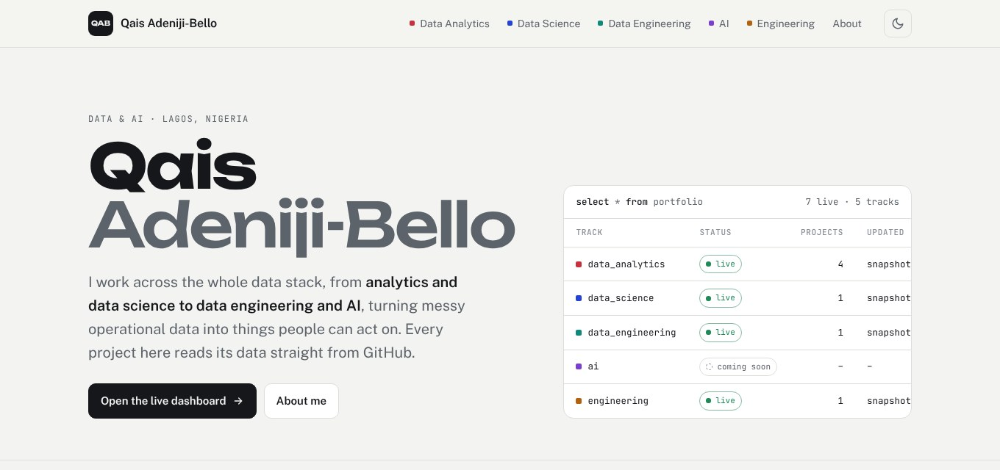

# Qais Adeniji-Bello

**Data & AI · Area Manager (Nigeria) at Guthrie AI · Lagos**

I work across the data stack: analytics, data science, data engineering and AI. I turn messy operational data into things people can act on, and I build the pipelines and tools that keep that data trustworthy. I trained in building construction, so I also write engineering and estimating tools as code.

<a href="https://qaisbello.github.io">
  <picture>
    <source media="(prefers-color-scheme: dark)" srcset="assets/portfolio-dark.jpg">
    
  </picture>
</a>

**Portfolio: [qaisbello.github.io](https://qaisbello.github.io).** Every project there is live and reads its data straight from its repo.

## Projects

| Track | Project | What it shows |
|---|---|---|
| Data Analytics | [**Lifeblood Ledger**](https://github.com/QaisBello/One-health-life-savers-blood-ledger) · [live](https://qaisbello.github.io/data-analytics/lifeblood-ledger/) | Three campus blood drives cleaned, de-identified and linked by donor, with a cross-filtering dashboard. |
| Data Analytics | [**Adidas Sales Audit**](https://github.com/QaisBello/adidas-sales-dashboard) · [live](https://qaisbello.github.io/data-analytics/adidas-sales/) | 40% of rows in a popular dataset are inflated tenfold. Fixing them cuts revenue from $899.9M to $120.2M and flips the channel ranking. |
| Data Analytics | [**World Cup Goal Clock**](https://github.com/QaisBello/world-cup-analysis) · [live](https://qaisbello.github.io/data-analytics/world-cup/) | Every World Cup goal, timed: 22% come in the last 15 minutes. Built on the open Fjelstul World Cup Database. |
| Data Analytics | [**Danny's Diner SQL**](https://github.com/QaisBello/dannys-diner-sql) · [live](https://qaisbello.github.io/data-analytics/dannys-diner/) | Ten SQL questions you can edit and run in the browser, each checked against expected answers. |
| Data Science | [**A/B Test Readout**](https://github.com/QaisBello/ab-test-readout) · [live](https://qaisbello.github.io/data-science/ab-test-readout/) | 290,584 users. The new page did not convert better (p = 0.19), and the test was large enough to detect a 0.34-point lift. Includes a power planner. |
| Data Engineering | [**Lifeblood Pipeline**](https://github.com/QaisBello/One-health-life-savers-blood-ledger-elt) · [live](https://qaisbello.github.io/data-engineering/lifeblood-pipeline/) | An automated ELT pipeline on GitHub Actions: a PII boundary, keyed donor IDs, quality gates that block a bad publish, and a full run history. |
| Engineering | [**Beam Lab**](https://github.com/QaisBello/slope-deflection-method) · [live](https://qaisbello.github.io/engineering/beam-lab/) | A slope-deflection beam solver in Python and JavaScript, tested against textbook results in CI. |
| Engineering | [**Breathing Room**](https://github.com/QaisBello/indoor-air-quality) · [live](https://qaisbello.github.io/engineering/indoor-air-quality/) | Five days of air readings in a full lecture theatre, rebuilt from raw logs: a 16-minute clock error fixed, and ventilation measured from CO₂ (about 2 L/s of fresh air per student). |

AI projects are coming soon.

## Toolkit

**Data & analysis:** SQL · Python (pandas, NumPy, statsmodels, SciPy) · R · SPSS · A/B testing · statistical modelling 
**Data engineering:** Snowflake · dbt · Databricks · BigQuery · Hightouch · data modelling & warehousing · GitHub Actions · Microsoft Azure 
**BI & visualisation:** Power BI · Tableau · Looker · Google Analytics · Excel · D3.js 
**Construction & estimating:** AutoCAD · Revit · Logikal · Bluebeam

## Contact

[LinkedIn](https://www.linkedin.com/in/qais-adeniji-bello/) · [Email](mailto:qaismoyo19@gmail.com) · [Portfolio](https://qaisbello.github.io)
